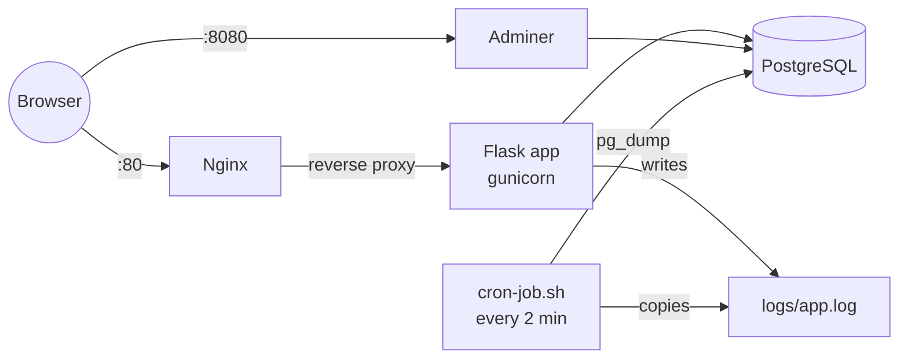
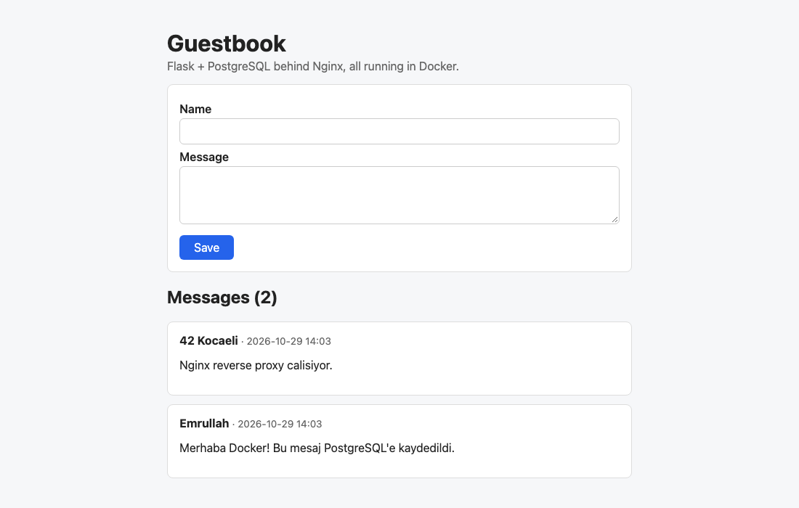
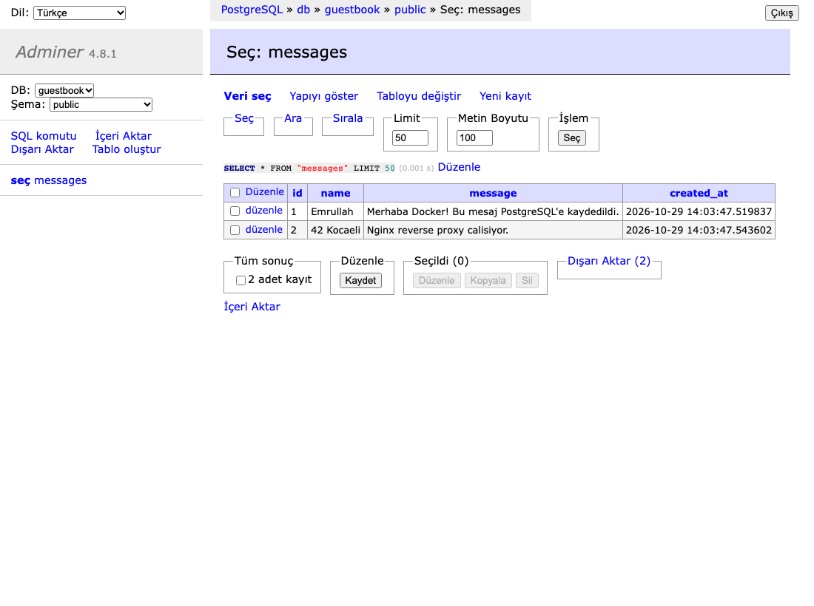

# Docker Guestbook


A multi-container application environment built with Docker and Linux tooling.
Visitors leave their name and a message through a Flask web app; messages are
stored in PostgreSQL, served through an Nginx reverse proxy, and can be browsed
in Adminer. On the Linux side, the stack runs as a systemd service and a cron
job archives logs and backs up the database every 2 minutes.

Final project for the Acunmedya Akademi DevOps bootcamp.

## Architecture



## Services

| Service | Image | Port | Role |
| --- | --- | --- | --- |
| `nginx` | nginx:1.27-alpine | 80 | Reverse proxy; the only way into the web app |
| `web` | built from `Dockerfile` | internal 5000 | Flask app: form + message list, logs to `logs/app.log` |
| `db` | postgres:16-alpine | internal 5432 | Stores the `messages(id, name, message, created_at)` table |
| `adminer` | adminer:4.8.1 | 8080 | Web UI to browse the database |

All services share the default Compose network and reach each other by service
name (`web`, `db`). Containers have healthchecks, and each one starts only after
the service it depends on is healthy.

## Run it

```bash
git clone https://github.com/emrullahtasci/docker-guestbook.git
cd docker-guestbook
cp .env.example .env          # change the passwords
docker compose up -d --build
```

- Web app: http://localhost
- Adminer: http://localhost:8080 (System: PostgreSQL, Server: `db`, user/password/database from `.env`)

If port 80 or 8080 is already in use, change `WEB_PORT` or `ADMINER_PORT` in `.env`.

Stop everything with `docker compose down` (add `-v` to also delete the database).

## Logging

The Flask app writes to `logs/app.log`, which is bind-mounted to the host:

```bash
tail -f logs/app.log
```

```
2026-10-29 14:03:37,475 [INFO] Application started
2026-10-29 14:03:47,522 [INFO] New message saved from Emrullah
```

## Run as a systemd service (Linux)

`myapp.service` manages the Compose stack, so it starts on boot and can be
controlled with `systemctl`. The unit expects the project in `/opt/myapp`:

```bash
sudo git clone https://github.com/emrullahtasci/docker-guestbook.git /opt/myapp
sudo cp /opt/myapp/myapp.service /etc/systemd/system/
sudo systemctl daemon-reload
sudo systemctl enable --now myapp
sudo systemctl status myapp
```

`sudo systemctl stop myapp` runs `docker compose down`.

## Cron job: log archive + database backup

`cron-job.sh` copies `logs/app.log` into `log_archive/` and saves a gzipped
`pg_dump` into `backups/`, keeping the newest 30 files in each. Add it to cron
with `crontab -e`:

```
*/2 * * * * /opt/myapp/cron-job.sh >> /opt/myapp/logs/cron.log 2>&1
```

Restore a backup:

```bash
gunzip -c backups/db_20261029_170348.sql.gz | docker compose exec -T db psql -U guestbook guestbook
```

## CI

GitHub Actions runs on every push:

1. **test**: pytest for the Flask app (form, validation, logging, health check)
2. **stack**: starts all four containers and checks that the app answers through
   Nginx, Adminer is up, the log file is written and the cron script produces a
   log archive and a database backup

## Screenshots

**Web app** (through Nginx, http://localhost)



**Adminer** showing the `messages` table



## Project layout

```
.
├── app/                  # Flask application
│   ├── __init__.py       # app factory + file logging
│   ├── models.py         # messages table
│   ├── routes.py         # form, list, /health
│   └── templates/index.html
├── nginx/nginx.conf      # reverse proxy config
├── docker-compose.yml
├── Dockerfile
├── myapp.service         # systemd unit
├── cron-job.sh           # log archive + DB backup
├── logs/  log_archive/  backups/
├── screenshots/
└── tests/
```
