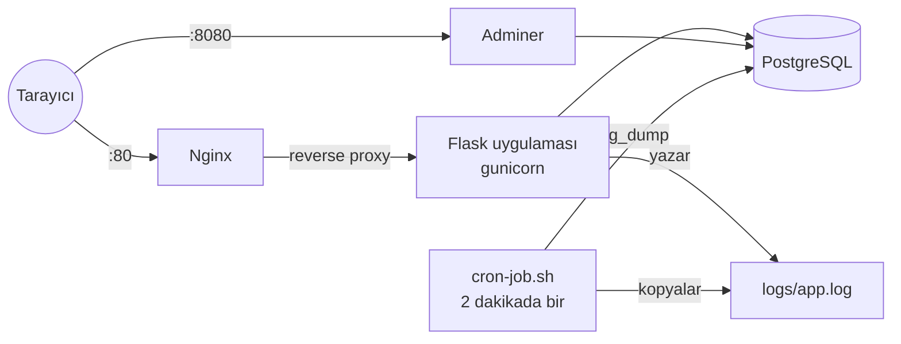

# Docker Guestbook


Docker ve Linux araçlarıyla kurulmuş, çok container'lı bir uygulama ortamı.
Ziyaretçiler Flask web uygulamasındaki formdan isim ve mesaj bırakır. Mesajlar
PostgreSQL'e kaydedilir, uygulama Nginx reverse proxy arkasından sunulur ve
veritabanı Adminer ile görüntülenebilir. Linux tarafında tüm ortam bir systemd
servisi olarak çalışır, bir cron görevi de 2 dakikada bir logları arşivleyip
veritabanının yedeğini alır.

Acunmedya Akademi DevOps Bootcamp final projesidir.

## Mimari



## Servisler

| Servis | Image | Port | Görevi |
| --- | --- | --- | --- |
| `nginx` | nginx:1.27-alpine | 80 | Reverse proxy; web uygulamasına tek giriş noktası |
| `web` | `Dockerfile`'dan build | iç 5000 | Flask uygulaması: form + mesaj listesi, `logs/app.log` dosyasına log yazar |
| `db` | postgres:16-alpine | iç 5432 | `messages(id, name, message, created_at)` tablosunu saklar |
| `adminer` | adminer:4.8.1 | 8080 | Veritabanını tarayıcıdan görüntüleme arayüzü |

Tüm servisler aynı Compose ağındadır ve birbirlerine servis adıyla (`web`, `db`)
ulaşır. Her container'ın healthcheck'i vardır; bir servis, bağlı olduğu servis
sağlıklı olmadan başlamaz.

## Çalıştırma

```bash
git clone https://github.com/emrullahtasci/guestbook.git
cd guestbook
cp .env.example .env          # şifreleri değiştir
docker compose up -d --build
```

- Web uygulaması: http://localhost
- Adminer: http://localhost:8080 (Sistem: PostgreSQL, Sunucu: `db`, kullanıcı/şifre/veritabanı `.env` dosyasından)

80 veya 8080 portu doluysa `.env` dosyasındaki `WEB_PORT` veya `ADMINER_PORT` değerini değiştir.

Her şeyi durdurmak için `docker compose down` (veritabanını da silmek için `-v` ekle).

## Loglama

Flask uygulaması host'a bind mount ile bağlı `logs/app.log` dosyasına log yazar:

```bash
tail -f logs/app.log
```

```
2026-10-29 14:03:37,475 [INFO] Application started
2026-10-29 14:03:47,522 [INFO] New message saved from Emrullah
```

## systemd servisi olarak çalıştırma (Linux)

`myapp.service` Compose ortamını yönetir; böylece proje sunucu açılışında
otomatik başlar ve `systemctl` ile kontrol edilir. Servis dosyası projenin
`/opt/myapp` klasöründe olmasını bekler:

```bash
sudo git clone https://github.com/emrullahtasci/guestbook.git /opt/myapp
sudo cp /opt/myapp/myapp.service /etc/systemd/system/
sudo systemctl daemon-reload
sudo systemctl enable --now myapp
sudo systemctl status myapp
```

`sudo systemctl stop myapp` komutu `docker compose down` çalıştırır.

## Cron görevi: log arşivi + veritabanı yedeği

`cron-job.sh`, `logs/app.log` dosyasını `log_archive/` klasörüne kopyalar ve
gzip ile sıkıştırılmış bir `pg_dump` yedeğini `backups/` klasörüne kaydeder.
Disk dolmasın diye her klasörde en yeni 30 dosya tutulur. `crontab -e` ile
cron'a eklemek için:

```
*/2 * * * * /opt/myapp/cron-job.sh >> /opt/myapp/logs/cron.log 2>&1
```

Bir yedeği geri yüklemek için:

```bash
gunzip -c backups/db_20261029_170348.sql.gz | docker compose exec -T db psql -U guestbook guestbook
```

## CI

GitHub Actions her push'ta çalışır:

1. **test**: Flask uygulaması için pytest (form, doğrulama, loglama, health check)
2. **stack**: dört container'ı ayağa kaldırır; uygulamanın Nginx üzerinden cevap
   verdiğini, Adminer'ın açıldığını, log dosyasının yazıldığını ve cron
   script'inin log arşivi ile veritabanı yedeği oluşturduğunu kontrol eder

## Ekran görüntüleri

**Web uygulaması** (Nginx üzerinden, http://localhost)


**Adminer**: `messages` tablosu


## Proje yapısı

```
.
├── app/                  # Flask uygulaması
│   ├── __init__.py       # uygulama oluşturma + dosyaya loglama
│   ├── models.py         # messages tablosu
│   ├── routes.py         # form, liste, /health
│   └── templates/index.html
├── nginx/nginx.conf      # reverse proxy ayarları
├── docker-compose.yml
├── Dockerfile
├── myapp.service         # systemd servis dosyası
├── cron-job.sh           # log arşivi + veritabanı yedeği
├── logs/  log_archive/  backups/
├── screenshots/
└── tests/
```
